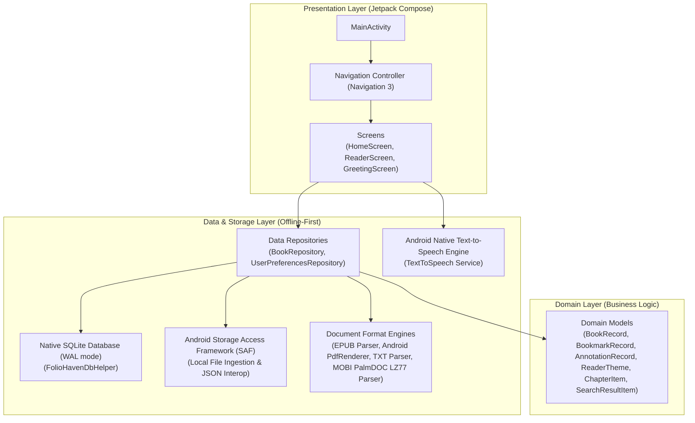

# FolioHaven Mobile Architecture

FolioHaven Mobile is designed as a **100% offline-first, native Android application** using **Kotlin**, **Jetpack Compose**, and **Material 3**. It adheres to modern Android Clean Architecture principles with clear separation of concerns across Presentation, Domain, and Data layers.

---

## 🏛️ High-Level System Layers

---

## 📱 1. Presentation Layer

The presentation layer is built exclusively with **Jetpack Compose** (Material 3).

### Unidirectional Data Flow (UDF)
Every screen follows strict UDF:
- **UI State:** Exposed by Repositories and ViewModels as immutable `StateFlow<List<BookRecord>>`.
- **UI Events:** Screen components dispatch user actions (`BookClicked`, `SearchQueryChanged`, `FilterSelected`, `PageScrolled`) to Repositories.
- **Compose Rendering:** Screens collect state via `collectAsStateWithLifecycle()` to prevent background resource leaks.

---

## 🧠 2. Domain & Data Models

The domain models encapsulate literary library concepts:
- **`BookRecord`**: Represents an ingested document (file hash identifier, title, author, file format, cover gradients, category, current page, total pages, progress percentage, completion status).
- **`BookmarkRecord`**: Saved page markers with surrounding contextual snippets.
- **`AnnotationRecord`**: Highlighted passages with 4 archival colors (Amber, Emerald, Azure, Rose) and attached reflection notes.
- **`ChapterItem`**: Table of Contents entry containing chapter title and target page index.
- **`SearchResultItem`**: In-book text search hit containing page number, chapter heading, surrounding context snippet, and matched keyword.
- **`ReaderTheme`**: 4 Archival palettes (Day, Sepia Parchment, OLED Night, Dark Sepia).

---

## 💾 3. Data & Storage Layer

All persistence is local to the device with **zero cloud dependencies**:

### Local SQLite Database (`FolioHavenDbHelper`)
- **`books` Table**: Stores book metadata, SHA-256 binary deduplication hash, local file path, format, and category.
- **`reading_progress` Table**: Tracks last read position, progress percentage, cumulative reading time in seconds, and completion status.
- **`bookmarks` & `annotations` Tables**: Stores user bookmarks, highlights, and reflection notes with cascading foreign keys.
- **WAL Mode & Foreign Keys:** SQLite operates in Write-Ahead Logging mode (`enableWriteAheadLogging()`) with active foreign key constraints.

### Storage Access Framework (SAF)
Files are ingested via Android's `ActivityResultContracts.OpenDocument()` and safely copied into app-private storage (`context.filesDir/books/`). User data can be backed up and restored via portable `foliohaven_backup.json` matching the desktop `Foliohaven-pc` schema.

### Document Format Engines (`DocumentEngine.kt`)
1. **PDF Engine (`AndroidPdfDocumentReader`):**
   - Native hardware-accelerated `android.graphics.pdf.PdfRenderer` rendering crisp ARGB_8888 bitmaps for display.
2. **Clean-Room EPUB Reflow Engine (`EpubDocumentReader`):**
   - Pure Kotlin `ZipInputStream` decompressor that extracts manifest HTML/XHTML entries and `toc.ncx` / `nav.xhtml` Table of Contents without third-party bundle bloat.
3. **MOBI / AZW Engine (`MobiDocumentReader`):**
   - Clean-room Palm Database (PDB) header parser and PalmDOC LZ77 decompressor extracting and paginating text chunks.
4. **Plain Text Engine (`PlainTextDocumentReader`):**
   - Word-boundary paragraph chunking and regex chapter detection (`CHƯƠNG`, `PHẦN`, `CHAPTER`, `#`).
5. **In-Book Text Search & Table of Contents:**
   - Real-time search across all text pages returning surrounding context snippets.
   - Chapter outline list with 1-tap direct page navigation.
