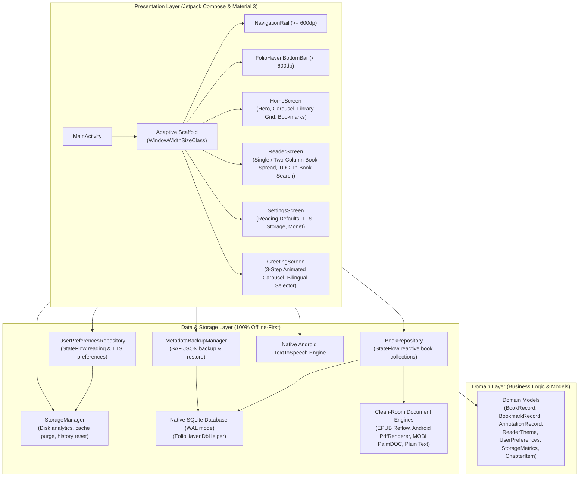

# FolioHaven Mobile Architecture

FolioHaven Mobile is designed as a **100% offline-first, native Android application** using **Kotlin**, **Jetpack Compose**, and **Material 3**. It adheres to modern Android Clean Architecture principles with clear separation of concerns across Presentation, Domain, and Data layers.

---

## 🏛️ High-Level System Architecture

---

## 📱 1. Presentation Layer

The presentation layer is written completely in **Jetpack Compose** using **Material Design 3**.

### Adaptive Form Factor Architecture (`WindowWidthSizeClass`)
FolioHaven dynamically adapts its UI to the running device form factor:
- **Compact (`< 600dp` — Standard Handheld Phones):**
  - Uses [`FolioHavenBottomBar`](file:///C:/Users/epicg/orca/foliohaven-mobile/app/src/main/kotlin/com/example/foliohaven/HomeScreen.kt) with 4 icon navigation destinations (Trang chủ, Kệ sách, Dấu trang, Cài đặt).
  - Single-column reading canvas constrained to a maximum measure of `760dp` for optical ergonomics.
  - 2-column library shelf grid.
- **Medium & Expanded (`≥ 600dp` — Foldables, Tablets, Large Screens):**
  - Replaces the bottom bar with an ergonomic left-hand [`NavigationRail`](file:///C:/Users/epicg/orca/foliohaven-mobile/app/src/main/kotlin/com/example/foliohaven/HomeScreen.kt) featuring the brand monogram and direct SAF import FAB.
  - **Two-Column Book Spread (Trang đôi 2 cột như sách in):** Automatically renders the reader canvas in a printed double-page spread with an archival vertical divider gutter, constrained to `widthIn(max = 1120.dp)`.
  - Responsive library grid scaling dynamically via `GridCells.Adaptive(minSize = 160.dp)` (3 to 6 columns).
  - Multi-column notes/bookmarks grid using `GridCells.Adaptive(minSize = 280.dp)`.
  - Centered modal dialogs constrained to `widthIn(max = 540.dp)`.

### Material Design 3 & Material You (Monet)
- **Dynamic Theming:** Supported on Android 12+ (API 31+) via `dynamicDarkColorScheme()` and `dynamicLightColorScheme()` in [`Theme.kt`](file:///C:/Users/epicg/orca/foliohaven-mobile/app/src/main/kotlin/com/example/foliohaven/ui/theme/Theme.kt). When disabled or on older Android versions, falls back gracefully to FolioHaven's signature Terracotta (`#C2410C`) and Archival Charcoal palettes.
- **M3 Shapes:** Centralized in [`Shape.kt`](file:///C:/Users/epicg/orca/foliohaven-mobile/app/src/main/kotlin/com/example/foliohaven/ui/theme/Shape.kt) using `FolioHavenShapes` (ExtraSmall 4dp, Small 8dp, Medium 12dp, Large 16dp, ExtraLarge 28dp).
- **M3 Controls:** Search bar with 28dp pill geometry and `surfaceContainerHigh` color, M3 `FilterChip` category selectors, and `ExtendedFloatingActionButton`.

### Stepped Onboarding Carousel (`GreetingScreen.kt`)
- Implemented as a 3-step animated carousel utilizing `AnimatedContent` with coordinated slide and fade transitions.
- Includes a live bi-lingual toggle (Tiếng Việt and English) persisting to preferences and instantly updating UI state and TTS locale.

### Zero-Dependency Vector Icons
- All icons across the app (Navigation, Reader, Settings, Storage) are authored as pure `@Composable` Canvas drawing routines in [`SettingsIcons.kt`](file:///C:/Users/epicg/orca/foliohaven-mobile/app/src/main/kotlin/com/example/foliohaven/ui/icons/SettingsIcons.kt) and [`ReaderIcons.kt`](file:///C:/Users/epicg/orca/foliohaven-mobile/app/src/main/kotlin/com/example/foliohaven/ui/icons/ReaderIcons.kt), eliminating bloat from large third-party icon libraries.

---

## 🧠 2. Domain & Data Models

- **`BookRecord`**: Represents an ingested document (file hash identifier, title, author, file format, cover gradients, category, current page, total pages, progress percentage, completion status).
- **`BookmarkRecord`**: Saved page markers with surrounding contextual snippets.
- **`AnnotationRecord`**: Highlighted passages with 4 archival colors (Amber, Emerald, Azure, Rose) and attached reflection notes.
- **`ChapterItem`**: Table of Contents entry containing chapter title and target page index.
- **`SearchResultItem`**: In-book text search hit containing page number, chapter heading, surrounding context snippet, and matched keyword.
- **`ReaderTheme`**: 4 Archival palettes (Day, Sepia Parchment, OLED Night, Dark Sepia).
- **`UserPreferences`**: Data class encapsulating reading defaults (theme, font size, line spacing, margins, two-column mode), TTS defaults (rate, pitch, locale), language (`vi` / `en`), dynamic color flag, and onboarding completion status.
- **`StorageMetrics`**: Immutable snapshot of disk utilization (book file count, total books size, cache size, SQLite database size, and combined disk consumption).

---

## 💾 3. Data & Storage Layer

All persistence is completely local to the device with **zero cloud dependencies**:

### Zero Network Permissions
The application does not declare `android.permission.INTERNET` in its manifest. This hard guarantee ensures no telemetric data, reading history, or personal documents can ever leave the user's device.

### Local SQLite Database (`FolioHavenDbHelper`)
- **`books` Table**: Stores book metadata, SHA-256 binary deduplication hash, local file path, format, and category.
- **`reading_progress` Table**: Tracks last read position, progress percentage, cumulative reading time in seconds, and completion status.
- **`bookmarks` & `annotations` Tables**: Stores user bookmarks, highlights, and reflection notes with cascading foreign keys.
- **WAL Mode & Foreign Keys:** SQLite operates in Write-Ahead Logging mode (`enableWriteAheadLogging()`) with active foreign key constraints.

### User Preferences Repository (`UserPreferencesRepository.kt`)
- Backed by Android `SharedPreferences` with cached, reactive `StateFlow<UserPreferences>`.
- Enforces boundary sanitization on inputs (font sizes `12f` - `32f`, line heights `1.2f` - `2.4f`, margins `8` - `48dp`, speech rates `0.5f` - `2.0f`).
- Supports JSON serialization for settings export and restore.

### Storage & Maintenance Engine (`StorageManager.kt`)
- Queries Android storage directories to calculate live disk usage across books, cache, and SQLite databases.
- Provides atomic operations to clear temporary cache files and reset reading statistics with full error recovery.

### Storage Access Framework (SAF) & Backup (`MetadataBackupManager.kt`)
- Books are ingested via Android's `ActivityResultContracts.OpenDocument()` and safely copied into app-private storage (`context.filesDir/books/`).
- User data can be exported and imported as structured, version-controlled JSON files compatible with `Foliohaven-pc`.

### Document Format Engines (`DocumentEngine.kt`)
1. **PDF Engine (`AndroidPdfDocumentReader`):**
   - Native hardware-accelerated `android.graphics.pdf.PdfRenderer` rendering crisp ARGB_8888 bitmaps for display.
2. **Clean-Room EPUB Reflow Engine (`EpubDocumentReader`):**
   - Pure Kotlin `ZipInputStream` decompressor that extracts manifest HTML/XHTML entries and `toc.ncx` / `nav.xhtml` Table of Contents without third-party bundle bloat.
3. **MOBI / AZW Engine (`MobiDocumentReader`):**
   - Clean-room Palm Database (PDB) header parser and PalmDOC LZ77 decompressor extracting and paginating text chunks.
4. **Plain Text Engine (`PlainTextDocumentReader`):**
   - Word-boundary paragraph chunking and regex chapter detection (`CHƯƠNG`, `PHẦN`, `CHAPTER`, `#`).
5. **In-Book Text Search & Table of Contents:**
   - Real-time search across all text pages returning surrounding context snippets.
   - Chapter outline list with 1-tap direct page navigation.
