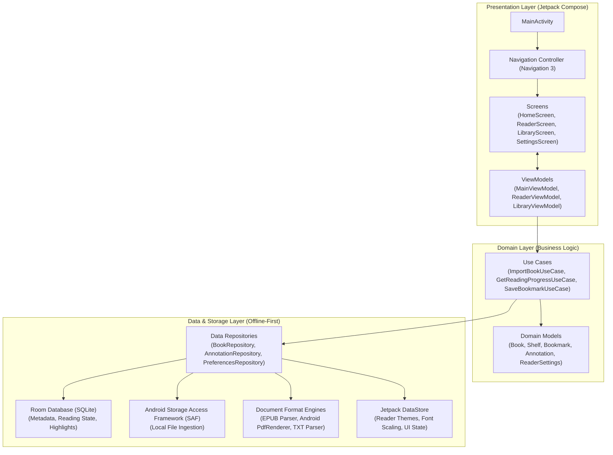

# FolioHaven Mobile Architecture

FolioHaven Mobile is designed as a **100% offline-first, native Android application** using **Kotlin**, **Jetpack Compose**, and **Material 3**. It adheres to modern Android Clean Architecture principles with clear separation of concerns across Presentation, Domain, and Data layers.

---

## 🏛️ High-Level System Layers



---

## 📱 1. Presentation Layer

The presentation layer is built exclusively with **Jetpack Compose** (Material 3).

### Unidirectional Data Flow (UDF)
Every screen follows strict UDF:
- **UI State:** Exposed by ViewModels as immutable `StateFlow<UiState>`.
- **UI Events:** Screen components dispatch user actions (`BookClicked`, `PageScrolled`, `FilterChanged`) to ViewModels.
- **Compose Rendering:** Screens collect state via `collectAsStateWithLifecycle()` to prevent background resource leaks.

```kotlin
// Example State Machine Pattern
sealed interface ReaderUiState {
    data object Loading : ReaderUiState
    data class Content(
        val book: Book,
        val currentPage: Int,
        val totalPages: Int,
        val theme: ReaderTheme,
        val fontSizeSp: Float
    ) : ReaderUiState
    data class Error(val message: String) : ReaderUiState
}
```

### Navigation
The app utilizes `androidx.navigation3` for type-safe route handling and declarative back stack management.

---

## 🧠 2. Domain Layer

The domain layer contains pure Kotlin business rules, independent of Android framework dependencies:
- **`Book`**: Core domain entity representing an imported book (hash identifier, title, author, file format, cover URI, total chapters/pages).
- **`ReadingState`**: Current reading position (page index or EPUB CFI locator, percentage completion, last read timestamp).
- **`Annotation`**: Highlighted passages, color codes (Amber, Emerald, Azure, Rose), and attached user notes.
- **Use Cases**: Encapsulate single business tasks such as `ImportBookUseCase`, `CalculateReadingStreakUseCase`, and `ExportNotesUseCase`.

---

## 💾 3. Data & Storage Layer

All persistence is local to the device with **zero cloud dependencies**:

### Local SQLite Database (Room)
- **`books` Table**: Stores book metadata, SHA-256 content deduplication hash, local file URI, and cover thumbnail path.
- **`reading_progress` Table**: Tracks last read position, progress percentage, total read time in seconds, and completion status.
- **`bookmarks` & `annotations` Tables**: Stores user bookmarks, highlights with character offsets, and markdown notes.
- **`shelves` Table**: Manages custom user shelves (e.g., "Favorites", "Research", "Fiction").

### Storage Access Framework (SAF)
Files are ingested via Android's `Intent.ACTION_OPEN_DOCUMENT` and persisted into app-specific private storage (`context.filesDir/books/`) to ensure the user retains complete ownership and privacy over their literary library.

### Document Format Engines
- **PDF Engine:** Powered by Android's native `android.graphics.pdf.PdfRenderer` for hardware-accelerated, crisp vector and page rendering.
- **EPUB Engine:** Reflowable HTML/CSS renderer using Compose custom layout or embedded Android WebView with sandbox isolation, supporting dynamic font scaling, line height, and theme swaps.
- **TXT Engine:** Fast UTF-8/ASCII paragraph reflow with automatic chapter detection.

---

## 🔒 4. Privacy & Offline Guarantees

In alignment with the parent [FolioHaven specification](https://github.com/FeurisPT2/foliohaven):
1. **Zero Internet Permissions:** `android.permission.INTERNET` is excluded from `AndroidManifest.xml`.
2. **Zero Analytics/Telemetry:** No third-party SDKs, crash trackers, or external network calls.
3. **Local Export:** Bookmarks, annotations, and reading lists can be exported directly to local JSON/HTML files.
