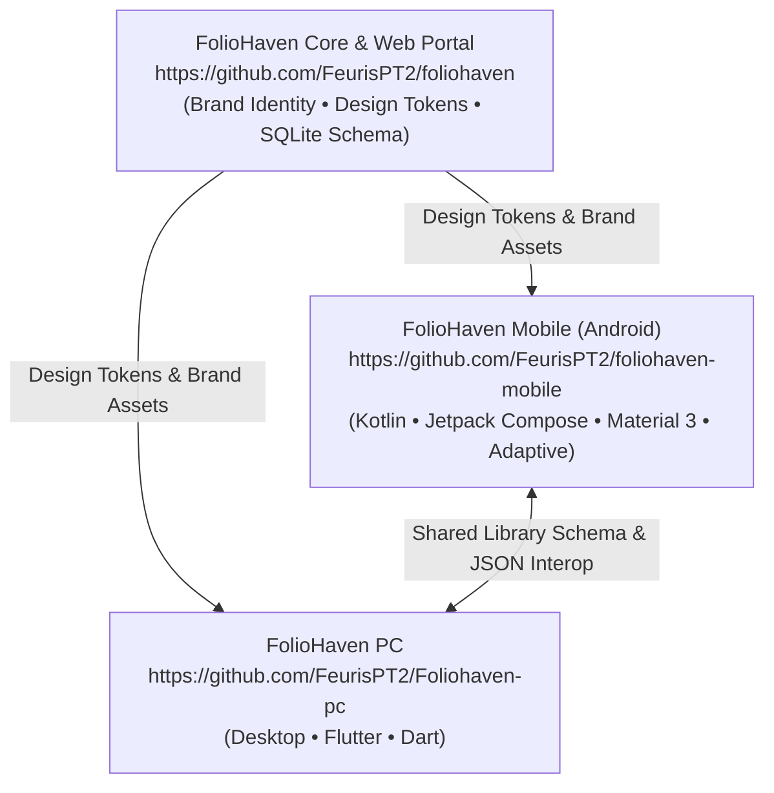

# FolioHaven Mobile Documentation

Welcome to the internal engineering and architectural documentation for **FolioHaven Mobile** (`foliohaven-mobile`), the native Android companion for the [FolioHaven Literary Ecosystem](https://github.com/FeurisPT2/foliohaven).

---

## 📚 Documentation Index

| Document | Description |
| :--- | :--- |
| **[Architecture Guide](ARCHITECTURE.md)** | Technical architecture, layered structure (UI/Domain/Data), adaptive form-factor engine (`WindowWidthSizeClass`), Jetpack Compose conventions, and state flow. |
| **[Implementation Roadmap](ROADMAP.md)** | Phased 10-step implementation roadmap from initial UI prototype to v1.0.0 production release. |
| **[Design Tokens & Brand Identity](DESIGN_TOKENS.md)** | Design tokens, Material 3 shapes, Dynamic Color Monet integration, typography scale, 3D archival book covers, and adaptive layout measures. |
| **[Ecosystem & Feature Parity](ECOSYSTEM_PARITY.md)** | Feature comparison between the upstream web portal (`foliohaven`), desktop client (`Foliohaven-pc`), and mobile client. |
| **[Development & Build Guide](DEVELOPMENT.md)** | Local environment setup, SDK configuration, Gradle tasks, 110 unit tests, and release APK publishing. |

---

## 🏛️ Ecosystem Alignment

FolioHaven Mobile is designed to maintain strict philosophical and design parity with the FolioHaven ecosystem:

---

## 🌟 Core Pillars

1. **100% Offline & Private:** Zero account logins, zero telemetry tracking, and zero cloud lock-ins. The application explicitly omits the `android.permission.INTERNET` permission from its manifest. All books, bookmarks, reading notes, and reading states remain strictly local on the user's device.
2. **Adaptive Form Factors:** Seamless layout scaling across handheld phones, foldable devices (e.g. Galaxy Z Fold, Pixel Fold), and tablets (e.g. Pixel Tablet, Galaxy Tab), including dual-column book spread reading and dynamic navigation rails.
3. **Material Design 3 & Material You:** High-contrast OLED dark theme, archival sepia palettes, M3 pill search bars, dynamic color Monet theming on Android 12+, and M3 shape tokens.
4. **Archival Reading Craftsmanship:** Grounded in high-contrast OLED dark themes, warm parchment, antique sepia palettes, and balanced typography.
5. **Format Freedom:** Non-proprietary clean-room multi-format engines (EPUB 2/3, PDF, MOBI PalmDOC LZ77, and Plain Text).
