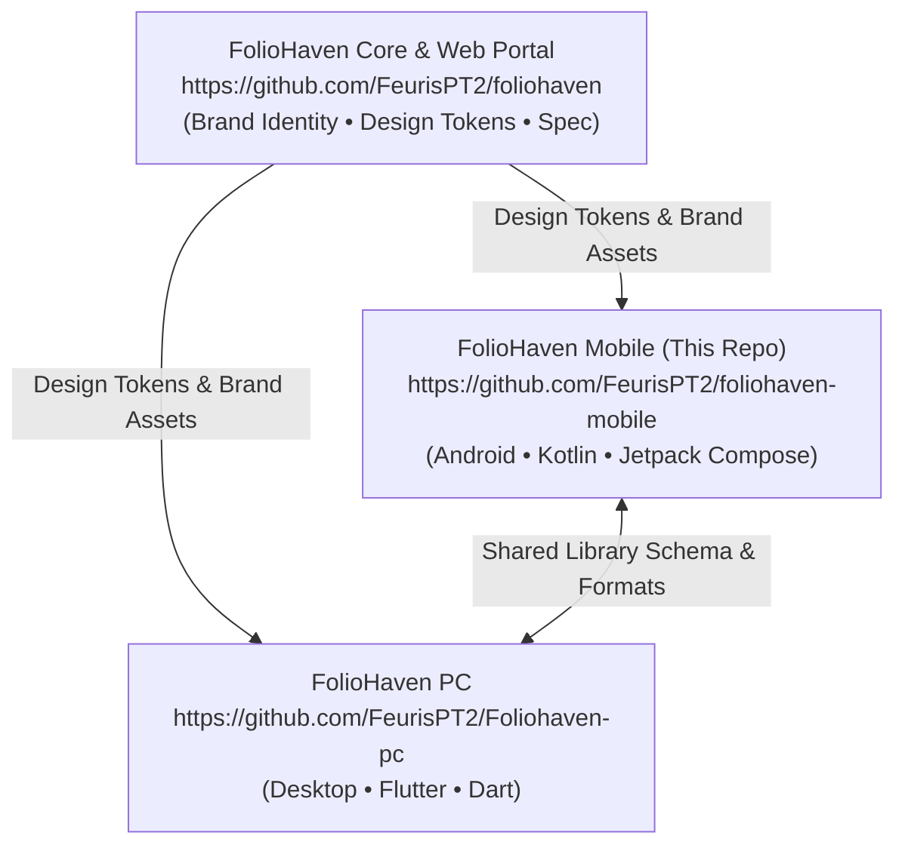

# FolioHaven Mobile Documentation

Welcome to the internal engineering and architectural documentation for **FolioHaven Mobile** (`foliohaven-mobile`), the native Android companion for the [FolioHaven Literary Ecosystem](https://github.com/FeurisPT2/foliohaven).

---

## 📚 Documentation Index

| Document | Description |
| :--- | :--- |
| **[Architecture Guide](ARCHITECTURE.md)** | Technical architecture, layered structure (UI/Domain/Data), Jetpack Compose conventions, and state flow. |
| **[Ecosystem & Feature Parity](ECOSYSTEM_PARITY.md)** | Feature comparison between the upstream web portal (`foliohaven`), desktop app (`Foliohaven-pc`), and mobile client. |
| **[Design Tokens & Brand Identity](DESIGN_TOKENS.md)** | Design tokens, color palettes, typography scale, 3D book covers, and WCAG accessibility standards. |
| **[Implementation Roadmap](ROADMAP.md)** | Step-by-step phased roadmap from UI prototype to a complete offline e-reader application. |
| **[Development & Build Guide](DEVELOPMENT.md)** | Local environment setup, SDK configuration, Gradle tasks, testing, and debugging. |

---

## 🏛️ Ecosystem Alignment

FolioHaven Mobile is derived from and synchronized with the parent repository:

### Core Philosophy
1. **100% Offline & Private:** Zero account logins, zero telemetry tracking, and zero cloud lock-ins. All books, bookmarks, reading notes, and reading states remain strictly local on the user's device.
2. **Archival Reading Craftsmanship:** Grounded in high-contrast OLED dark themes, warm parchment, antique sepia palettes, and balanced typography.
3. **Format Freedom:** Non-proprietary multi-format support (EPUB 2/3, PDF, MOBI, TXT).
