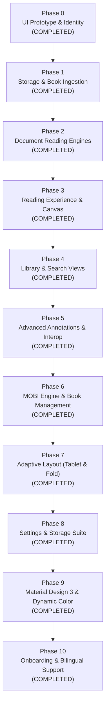

# FolioHaven Mobile Implementation Roadmap

This roadmap documents the phased engineering progression of FolioHaven Mobile from an initial visual prototype into a feature-complete, production-grade Android e-reader (v1.0.0).

---

## 🗺️ Phases Overview

---

## 🎯 Phase Details

### Phase 0: UI Prototype & Brand Alignment ✅ *(Completed)*
- [x] Design token extraction from upstream `foliohaven` ([`Color.kt`](file:///C:/Users/epicg/orca/foliohaven-mobile/app/src/main/kotlin/com/example/foliohaven/ui/theme/Color.kt)).
- [x] Dual typography hierarchy with serif titles and sans-serif UI ([`Type.kt`](file:///C:/Users/epicg/orca/foliohaven-mobile/app/src/main/kotlin/com/example/foliohaven/ui/theme/Type.kt)).
- [x] 3D archival embossed book covers with realistic lighting and spine creases.
- [x] Self-contained custom vector icons (Zero third-party icon bundle bloat).
- [x] Material 3 Dark and Light theme scaffold.
- [x] Debug build and packaging verification with Android SDK 36.

---

### Phase 1: Local Storage & Book Ingestion ✅ *(Completed)*
- [x] **Android Storage Access Framework (SAF):**
  - Integrated `rememberLauncherForActivityResult(ActivityResultContracts.OpenDocument())` with FAB.
  - Supports selecting `.epub`, `.pdf`, `.mobi`, and `.txt` files.
  - Automatically copies selected documents securely into `context.filesDir/books/`.
- [x] **Native SQLite Database Engine:**
  - Designed [`FolioHavenDbHelper.kt`](file:///C:/Users/epicg/orca/foliohaven-mobile/app/src/main/kotlin/com/example/foliohaven/data/db/FolioHavenDbHelper.kt) implementing the exact `schema.sql` from upstream `foliohaven`.
  - Enables Write-Ahead Logging (WAL mode), foreign key cascading, and performance indexes.
  - Computes SHA-256 cryptographic binary hash on ingestion to prevent duplicates.
- [x] **Reactive Book Repository & Seeding:**
  - Implemented [`BookRepository.kt`](file:///C:/Users/epicg/orca/foliohaven-mobile/app/src/main/kotlin/com/example/foliohaven/data/repository/BookRepository.kt) with reactive `StateFlow<List<BookRecord>>`.
  - Automatically seeds default sample classics (Sherlock Holmes, War and Peace, How to Win Friends, The Alchemist) on initial launch.

---

### Phase 2: Core Document Reading Engines ✅ *(Completed)*
- [x] **Native Android PDF Engine:**
  - Implemented `AndroidPdfDocumentReader` using `android.graphics.pdf.PdfRenderer`.
  - Hardware-accelerated bitmap page rendering with crisp aspect-ratio scaling.
- [x] **Clean-Room EPUB Reflow Engine:**
  - Implemented `EpubDocumentReader` using `ZipInputStream`.
  - Extracts and parses XHTML chapters and content into structured text.
- [x] **Plain Text Engine:**
  - Implemented `PlainTextDocumentReader` with word-boundary page chunking.
- [x] **Reader Screen:**
  - Implemented [`ReaderScreen.kt`](file:///C:/Users/epicg/orca/foliohaven-mobile/app/src/main/kotlin/com/example/foliohaven/ui/reader/ReaderScreen.kt) with interactive navigation from `HomeScreen`.

---

### Phase 3: Reading Canvas Customization ✅ *(Completed)*
- [x] **Archival Reading Palettes:**
  - Interactive runtime switcher for all 4 reading themes:
    - Day (`#FAF8F5`)
    - Sepia (`#F5EBD7`)
    - Night OLED (`#111111`)
    - Dark Sepia (`#221A14`)
- [x] **Dynamic Typography Controls:**
  - In-reader `A-` and `A+` font scaling controls (`12sp` to `32sp`) with proportional line heights.
- [x] **Progress & Position Persistence:**
  - Page navigation controls (prev/next buttons, page indicators, progress percentage).
  - Updates reading state in SQLite database on page changes.
  - In-reader bookmark ribbon toggle.

---

### Phase 4: Library Navigation & Live Search ✅ *(Completed)*
- [x] **Live Search Bar:**
  - Functional `BasicTextField` with search icon, clear button, and real-time title/author filtering.
- [x] **Dynamic Category Filter Chips:**
  - Filters books dynamically by format ("EPUB", "PDF", "MOBI") or genre ("Tiểu thuyết", "Kỹ năng sống", "Kinh điển").
- [x] **Multi-Tab Navigation:**
  - **Tab 0 (Home):** Continue Reading Hero, 3D Book Carousel, Reading Stats.
  - **Tab 1 (Library):** Responsive Grid of all indexed books with counts.
  - **Tab 2 (Bookmarks):** Dedicated list of saved bookmarks with quotes and page numbers.
  - **Tab 3 (Settings):** Security pledge, preferences, storage metrics, and ecosystem links.

---

### Phase 5: Advanced Features & Ecosystem Interop ✅ *(Completed)*
- [x] **In-Book Text Highlighting Toolbar:**
  - 4-color highlighter swatches (Amber `#FFE270`, Emerald `#A8F29A`, Azure `#7BE5F8`, Rose `#FFA0C5`).
  - Attached reflection notes, in-page annotation cards, and interactive quote saving in [`ReaderScreen.kt`](file:///C:/Users/epicg/orca/foliohaven-mobile/app/src/main/kotlin/com/example/foliohaven/ui/reader/ReaderScreen.kt).
- [x] **Interactive Bookmarks & Notes Tab:**
  - Real-time connected list of all bookmarks and highlights across all books in Tab 2 of [`HomeScreen.kt`](file:///C:/Users/epicg/orca/foliohaven-mobile/app/src/main/kotlin/com/example/foliohaven/HomeScreen.kt).
  - Category filters ("Tất cả", "Dấu trang", "Ghi chú"), delete actions, and one-tap jump to exact page.
- [x] **Text-to-Speech (TTS) Engine:**
  - Native Android `TextToSpeech` service read-aloud with speaker audio toggle and automated lifecycle management.
- [x] **Cross-Client Import/Export (.json):**
  - Portable JSON backup export and import format compatible with `Foliohaven-pc` and web portal via Android SAF.
- [x] **Greeting & Onboarding Flow:**
  - Initial onboarding implementation with brand identity and sample seeding.

---

### Phase 6: MOBI Engine, Search, TOC & Shelf Management ✅ *(Completed)*
- [x] **MOBI / AZW PalmDOC LZ77 Engine:**
  - Clean-room decompression of Palm Database (PDB) records without third-party dependencies in [`DocumentEngine.kt`](file:///C:/Users/epicg/orca/foliohaven-mobile/app/src/main/kotlin/com/example/foliohaven/data/reader/DocumentEngine.kt).
- [x] **Table of Contents (TOC) & Chapter Navigation:**
  - Chapter detection and outline parsing across EPUB, Plain Text, and MOBI formats.
  - Dedicated interactive TOC dialog with 1-tap jump and current chapter highlighting in [`ReaderScreen.kt`](file:///C:/Users/epicg/orca/foliohaven-mobile/app/src/main/kotlin/com/example/foliohaven/ui/reader/ReaderScreen.kt).
- [x] **In-Book Live Text Search:**
  - Fast background search across all text pages/chapters with hit counters and surrounding context snippets.
- [x] **Reading Experience Customization:**
  - Modal display settings (`Aa`) supporting 4 reading palettes, font scaling, line-height multipliers (`1.4x`, `1.6x`, `1.8x`, `2.0x`), and margins (`16dp`, `24dp`, `32dp`).
  - Active session timer tracking seconds read and persisting to SQLite reading progress.
- [x] **Book Management & Shelf Operations:**
  - Book card overflow actions (`⋮`) for Hero, Carousel, and Library Grid in [`HomeScreen.kt`](file:///C:/Users/epicg/orca/foliohaven-mobile/app/src/main/kotlin/com/example/foliohaven/HomeScreen.kt).
  - Edit metadata dialog (Title, Author, Category with quick suggestions).
  - Toggle mark finished / in-progress state.
  - Confirmation dialog for safe book deletion from database and device storage.

---

### Phase 7: Adaptive Layout for Tablets & Foldable Devices ✅ *(Completed)*
- [x] **Window Size Class Detection:**
  - Integrated `androidx.compose.material3.adaptive:adaptive` to evaluate `WindowWidthSizeClass` (Compact `< 600dp`, Medium `600dp - 839dp`, Expanded `≥ 840dp`).
- [x] **Adaptive Navigation Scaffold:**
  - Compact screens render bottom `FolioHavenBottomBar`.
  - Medium & Expanded screens render ergonomic left-hand `NavigationRail` with brand monogram header and floating action button.
- [x] **Tablet-Optimized Home & Library Shelves:**
  - 3-column split layout for the continue reading Hero card on wide viewports (Cover + Metadata/Progress + Quick Action CTA).
  - Adaptive grid for library shelf (`GridCells.Adaptive(minSize = 160.dp)`), seamlessly scaling from 2 to 6 columns.
  - Responsive multi-column grid for bookmarks and annotations (`GridCells.Adaptive(minSize = 280.dp)`).
- [x] **Two-Column Printed Book Spread (Trang đôi 2 cột như sách in):**
  - Reader screen detects wide viewports (`width >= 600dp`) and automatically splits content into a two-column book spread with an archival vertical gutter divider.
  - Preserves comfortable typographic measure (`widthIn(max = 1120.dp)`).
  - Compact viewports remain centered with single-column measure (`widthIn(max = 760.dp)`).
- [x] **Centered Adaptive Dialogs:**
  - Constrained dialog widths (`widthIn(max = 540.dp)`) preventing stretched modals on ultrawide tablet screens.

---

### Phase 8: Production Settings Suite & Storage Management ✅ *(Completed)*
- [x] **Comprehensive Preferences Repository:**
  - Implemented [`UserPreferencesRepository.kt`](file:///C:/Users/epicg/orca/foliohaven-mobile/app/src/main/kotlin/com/example/foliohaven/data/repository/UserPreferencesRepository.kt) backed by Android `SharedPreferences` with reactive `StateFlow`.
  - Persists reading defaults (font size, line spacing, margins, preferred theme, two-column mode).
  - Persists TTS defaults (speech rate, pitch, language preference).
  - Validates and sanitizes boundary limits to prevent out-of-range crashes.
- [x] **Storage Analytics & Maintenance Engine:**
  - Implemented [`StorageManager.kt`](file:///C:/Users/epicg/orca/foliohaven-mobile/app/src/main/kotlin/com/example/foliohaven/data/storage/StorageManager.kt) providing real-time disk breakdown (books size, cache size, SQLite database size).
  - One-tap cache cleaning and confirmation-protected reading history reset.
- [x] **Portable JSON Metadata Backup/Restore:**
  - Implemented [`MetadataBackupManager.kt`](file:///C:/Users/epicg/orca/foliohaven-mobile/app/src/main/kotlin/com/example/foliohaven/data/storage/MetadataBackupManager.kt) using SAF input/output streams with schema versioning.
- [x] **Production Settings UI:**
  - Created [`SettingsScreen.kt`](file:///C:/Users/epicg/orca/foliohaven-mobile/app/src/main/kotlin/com/example/foliohaven/ui/settings/SettingsScreen.kt) with live reading preview, TTS audio test button, and native Canvas icons in [`SettingsIcons.kt`](file:///C:/Users/epicg/orca/foliohaven-mobile/app/src/main/kotlin/com/example/foliohaven/ui/icons/SettingsIcons.kt).
- [x] **110 Unit Tests:**
  - Comprehensive unit test suite covering `UserPreferencesRepositoryTest`, `StorageManagerTest`, and parsers.

---

### Phase 9: Material Design 3 (M3) Upgrade & Material You ✅ *(Completed)*
- [x] **Dynamic Color Monet Integration:**
  - Added Material You dynamic wallpaper color integration on Android 12+ (API 31+) via `dynamicDarkColorScheme()` and `dynamicLightColorScheme()` in [`Theme.kt`](file:///C:/Users/epicg/orca/foliohaven-mobile/app/src/main/kotlin/com/example/foliohaven/ui/theme/Theme.kt).
  - User-configurable toggle in Settings (`useDynamicColor`), falling back to FolioHaven's signature Terracotta (`#C2410C`) & Archival Charcoal palette.
- [x] **M3 Shape Token System:**
  - Defined [`FolioHavenShapes`](file:///C:/Users/epicg/orca/foliohaven-mobile/app/src/main/kotlin/com/example/foliohaven/ui/theme/Shape.kt) with `RoundedCornerShape` tokens: ExtraSmall (4dp), Small (8dp), Medium (12dp), Large (16dp), ExtraLarge (28dp).
- [x] **M3 Component Migration:**
  - Upgraded category chips to Material 3 `FilterChip`.
  - Migrated search bar to M3 28dp pill shape with `surfaceContainerHigh` container color.
  - Adopted `ExtendedFloatingActionButton` and standard M3 elevation guidelines.

---

### Phase 10: Stepped Onboarding Carousel & Bi-lingual (EN/VI) Support ✅ *(Completed)*
- [x] **3-Step Animated Onboarding Flow:**
  - Rewrote [`GreetingScreen.kt`](file:///C:/Users/epicg/orca/foliohaven-mobile/app/src/main/kotlin/com/example/foliohaven/ui/greeting/GreetingScreen.kt) as a step-by-step carousel using `AnimatedContent` with smooth horizontal slide and fade transitions.
  - Step 0: Welcome, language selection (Tiếng Việt & English), Brand monogram.
  - Step 1: Core reading features (4 archival palettes, reflow engines, TTS).
  - Step 2: Privacy pledge (100% offline, zero network permissions, sample books toggle, Start reading CTA).
- [x] **Real-Time Language Selection:**
  - Interactive language switcher toggle on the greeting screen and in Settings.
  - Instant live UI language updates across the entire app without requiring an application restart.
  - Automatically synchronizes default TTS locale with the chosen language.
- [x] **Release Packaging & Distribution:**
  - Built pre-compiled release (`app-release.apk`) and debug (`app-debug.apk`) binaries under `release-apks/`.
  - Published official GitHub Release `v1.0.0` at [https://github.com/FeurisPT2/foliohaven-mobile/releases/tag/v1.0.0](https://github.com/FeurisPT2/foliohaven-mobile/releases/tag/v1.0.0).
