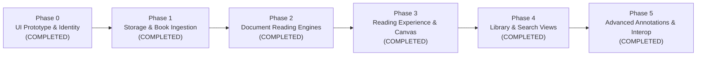

# FolioHaven Mobile Implementation Roadmap

This roadmap outlines the phased development plan to transform FolioHaven Mobile from a visual UI prototype into a production-grade, distraction-free Android e-reader.

---

## 🗺️ Phases Overview

---

## 🎯 Phase Details

### Phase 0: UI Prototype & Brand Alignment ✅ *(Completed)*
- [x] Design token extraction from upstream `foliohaven` ([`Color.kt`](file:///C:/Users/epicg/orca/foliohaven-mobile/app/src/main/kotlin/com/example/foliohaven/ui/theme/Color.kt)).
- [x] Dual typography hierarchy with serif titles and sans-serif UI ([`Type.kt`](file:///C:/Users/epicg/orca/foliohaven-mobile/app/src/main/kotlin/com/example/foliohaven/ui/theme/Type.kt)).
- [x] 3D archival embossed book covers with realistic lighting and spine creases.
- [x] Self-contained custom vector icons (Zero third-party icon bundle bloat).
- [x] Material 3 Dark and Light theme scaffold.
- [x] Debug build and packaging verification with Android SDK 36.

---

### Phase 1: Local Storage & Book Ingestion ✅ *(Completed)*
- [x] **Android Storage Access Framework (SAF):**
  - Integrated `rememberLauncherForActivityResult(ActivityResultContracts.OpenDocument())` with FAB.
  - Supports selecting `.epub`, `.pdf`, `.mobi`, and `.txt` files.
  - Automatically copies selected documents securely into `context.filesDir/books/`.
- [x] **Native SQLite Database Engine:**
  - Designed [`FolioHavenDbHelper.kt`](file:///C:/Users/epicg/orca/foliohaven-mobile/app/src/main/kotlin/com/example/foliohaven/data/db/FolioHavenDbHelper.kt) implementing the exact `schema.sql` from upstream `foliohaven`.
  - Enables Write-Ahead Logging (WAL mode), foreign key cascading, and performance indexes.
  - Computes SHA-256 cryptographic binary hash on ingestion to prevent duplicates.
- [x] **Reactive Book Repository & Seeding:**
  - Implemented [`BookRepository.kt`](file:///C:/Users/epicg/orca/foliohaven-mobile/app/src/main/kotlin/com/example/foliohaven/data/repository/BookRepository.kt) with reactive `StateFlow<List<BookRecord>>`.
  - Automatically seeds default sample classics (Sherlock Holmes, War and Peace, How to Win Friends, The Alchemist) on initial launch.

---

### Phase 2: Core Document Reading Engines ✅ *(Completed)*
- [x] **Native Android PDF Engine:**
  - Implemented `AndroidPdfDocumentReader` using `android.graphics.pdf.PdfRenderer`.
  - Hardware-accelerated bitmap page rendering with crisp aspect-ratio scaling.
- [x] **Clean-Room EPUB Reflow Engine:**
  - Implemented `EpubDocumentReader` using `ZipInputStream`.
  - Extracts and parses XHTML chapters and content into structured text.
- [x] **Plain Text Engine:**
  - Implemented `PlainTextDocumentReader` with word-boundary page chunking.
- [x] **Reader Screen:**
  - Implemented [`ReaderScreen.kt`](file:///C:/Users/epicg/orca/foliohaven-mobile/app/src/main/kotlin/com/example/foliohaven/ui/reader/ReaderScreen.kt) with interactive navigation from `HomeScreen`.

---

### Phase 3: Reading Canvas Customization ✅ *(Completed)*
- [x] **Archival Reading Palettes:**
  - Interactive runtime switcher for all 4 reading themes:
    - Day (`#FAF8F5`)
    - Sepia (`#F5EBD7`)
    - Night OLED (`#111111`)
    - Dark Sepia (`#221A14`)
- [x] **Dynamic Typography Controls:**
  - In-reader `A-` and `A+` font scaling controls (`12sp` to `32sp`) with proportional line heights.
- [x] **Progress & Position Persistence:**
  - Page navigation controls (prev/next buttons, page indicators, progress percentage).
  - Updates reading state in SQLite database on page changes.
  - In-reader bookmark ribbon toggle.

---

### Phase 4: Library Navigation & Live Search ✅ *(Completed)*
- [x] **Live Search Bar:**
  - Functional `BasicTextField` with search icon, clear button, and real-time title/author filtering.
- [x] **Dynamic Category Filter Chips:**
  - Filters books dynamically by format ("EPUB", "PDF") or genre ("Tiểu thuyết", "Kỹ năng sống", "Kinh điển").
- [x] **Multi-Tab Bottom Navigation:**
  - **Tab 0 (Home):** Continue Reading Hero, 3D Book Carousel, Reading Stats.
  - **Tab 1 (Library):** 2-Column Responsive Grid of all indexed books with counts.
  - **Tab 2 (Bookmarks):** Dedicated list of saved bookmarks with quotes and page numbers.
  - **Tab 3 (Settings):** 100% Offline & Private Security pledge and official ecosystem links.

---

### Phase 5: Advanced Features & Ecosystem Interop ✅ *(Completed)*
- [x] **In-Book Text Highlighting Toolbar:**
  - 4-color highlighter swatches (Amber `#FFE270`, Emerald `#A8F29A`, Azure `#7BE5F8`, Rose `#FFA0C5`).
  - Attached reflection notes, in-page annotation cards, and interactive quote saving in [`ReaderScreen.kt`](file:///C:/Users/epicg/orca/foliohaven-mobile/app/src/main/kotlin/com/example/foliohaven/ui/reader/ReaderScreen.kt).
- [x] **Interactive Bookmarks & Notes Tab:**
  - Real-time connected list of all bookmarks and highlights across all books in Tab 2 of [`HomeScreen.kt`](file:///C:/Users/epicg/orca/foliohaven-mobile/app/src/main/kotlin/com/example/foliohaven/HomeScreen.kt).
  - Category filters ("Tất cả", "Dấu trang", "Ghi chú"), delete actions, and one-tap jump to exact page.
- [x] **Text-to-Speech (TTS) Engine:**
  - Native Android `TextToSpeech` service read-aloud with speaker audio toggle and automated lifecycle management.
- [x] **Cross-Client Import/Export (.json):**
  - Portable JSON backup export and import format compatible with `Foliohaven-pc` and web portal via Android SAF.
